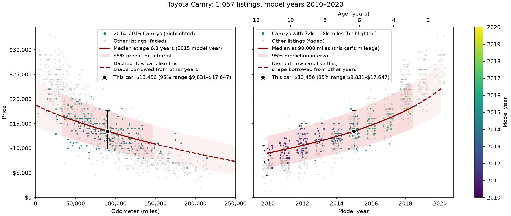
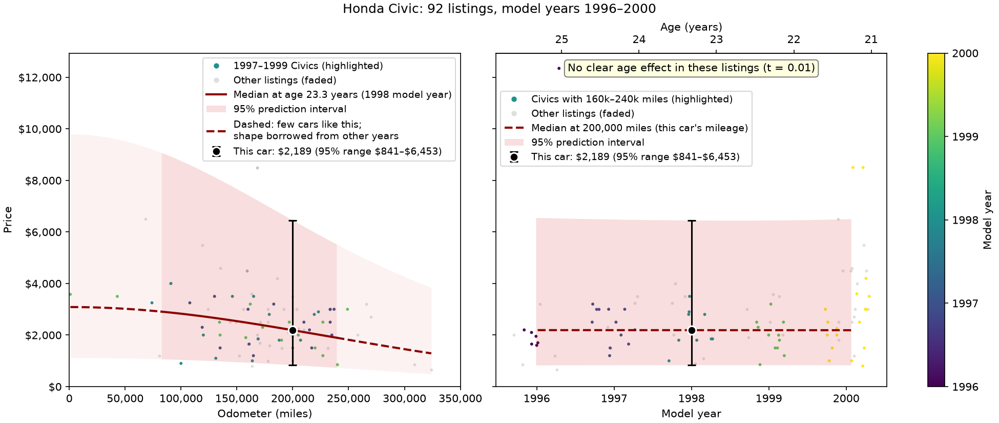

# Vehicle price prediction

I describe a used car in plain English, and Claude reads the description. A statistical model I built on about 320,000 Craigslist listings from 2021 then estimates the car's price with a 95% range. It also shows how the car loses value with mileage and with age.



## How well it works

I tested the model with 5-fold cross-validation on six popular models: Camry, Accord, Civic, Tacoma, F-150 and Silverado 1500, using 2010–2020 listings. Each listing is priced by a model that never saw it. Outliers were removed from the training folds only; the listings being priced were never dropped or changed.

| Model | Median % error | 95% coverage | Median interval width |
|---|---|---|---|
| Final model: mileage, age, clean title, 4WD | 10.6% | 94.9% | $13,521 |
| Week 3 model: mileage only, one model per year | 11.1% | 97.1% | $17,289 |

These are averages over the six cars, on plausible listings. Coverage is the share of real prices that fall inside the 95% range, so it should be close to 95%.

The final model is slightly more accurate. Its ranges are honest (about 95%) and narrower. It can also price every listing, while the per-year model can't price 55 of them, because some model years have too few cars to fit their own model. The full tables are in [docs/evaluation.md](docs/evaluation.md).

## How it works

1. Claude turns the description into a validated query (a pydantic model).
2. I pick listings of the same make and model within ±5 model years, or in the year range the user gives.
3. I drop implausible prices with a robust rule based on the median absolute deviation (MAD).
4. I fit a Box-Cox multiple regression of price on mileage, age, clean title and 4WD:

   ```
   boxcox(price, λy) = b0 + b1·boxcox(miles, λx) + b2·boxcox(age + 1, λa)
                          + b3·clean_title + b4·four_wd
   ```

5. I predict the median price with a 95% prediction interval.
6. I draw the mileage and age curves with the car marked, dashed where few similar cars exist.

## Design decisions

- **Multiple regression, not simple regression.** On 2010–2020 Camrys, a plain linear fit gives about −$1,041 per 10,000 miles with mileage alone. With age added, it's −$451 per 10,000 miles plus −$1,286 per year. High-mileage cars are also older, so mileage alone takes the blame for age (omitted variable bias).
- **One model across ±5 model years, not one per year.** That's the only way to estimate an age effect, and it gives the mileage effect more data.
- **Box-Cox λs chosen by maximum likelihood, not R².** When I chose them by R², the λ for price kept hitting the edge of the search range.
- **A relative outlier rule, not a price floor.** 50 of the 51 Camrys under $3,000 had clean titles, so they look like down-payment ads, not damaged cars. But $2,000 is a real price for a 1998 Civic. The rule flags prices far from what the model expects for that car's mileage and age.
- **Extra variables chosen by cross-validation.** Clean title and 4WD helped. 4WD mainly helps trucks: the Tacoma's error went from 11.3% to 9.8% with both added (clean title alone gave 11.1%). An age × mileage interaction and squared terms didn't help, because Box-Cox already handles the curvature. TODO(Jacob): these interaction and squared-term results aren't in docs/evaluation.md yet.
- **Missing title status is imputed as clean.** It affects 1.5% of listings, and clean is by far the most common value. Lien titles count as clean too, since a lien is a loan, not damage.
- **One outlier-removal pass.** Cross-validation showed no real difference between one pass and three.
- **Honest plots.** Each curve highlights the listings it describes and fades the rest. It turns dashed where the car's mileage is unusual for its age. That's hidden extrapolation: age and mileage are correlated (r ≈ 0.70), so those parts of the curve borrow their shape from other model years.

## Limitations

- The listings are from April–May 2021, so prices are in 2021 dollars.
- Age is effectively model year, since every listing was posted within the same month.
- The smooth age curve can't jump at redesigns. Camry 2012 and 2018 cars sit off the curve, and the per-year model still wins on the Camry and the Silverado.
- Narrow or old windows, such as 1996–2000 Civics, show no measurable age effect. The plot says so.
- Coverage is measured on plausible listings. On all listings, including junk ads, it's about 91%.
- When the user gives no drivetrain, the price is averaged over the 4WD/2WD mix in the listings.

## Future work

- A comparison window based on the car's generation instead of ±5 model years: Claude looks up the generation's years on the web, and the result is cached. This eliminates the bias introduced by new generations being priced differently
- A website: a single `estimate()` pipeline function, a JSON API, and interactive Plotly charts.


## Setup (once)

You need Python 3.12 or newer ([python.org](https://www.python.org/downloads/)) and an Anthropic API key ([console.anthropic.com](https://console.anthropic.com/)). Open a terminal in this folder and run:

**Windows**
```
python -m venv venv
venv\Scripts\activate
pip install -e .
copy .env.example .env
```

**Mac / Linux**
```
python3 -m venv venv
source venv/bin/activate
pip install -e .
cp .env.example .env
```

This creates a `venv` folder holding a private copy of Python with the libraries the project needs, so nothing else on your computer is changed.

Then open `.env` and paste your key after `ANTHROPIC_API_KEY=`. Git ignores `.env`, so your key stays out of the repo. Never put the key in `.env.example` or in the code.

If Windows PowerShell refuses to run `activate` with a "running scripts is disabled" error, skip activating and start commands with `venv\Scripts\python` instead, for example `venv\Scripts\python main.py`.

## Running

With the venv activated:
```
python main.py
```

Describe a vehicle, for example:

```
> 2015 Toyota Camry, 90,000 miles
```

It prints the estimated price and its 95% range, then opens two plot windows: the depreciation curves (your vehicle marked on them), and the residuals. Close both windows to ask again; typing `quit` exits.

The depreciation window shows price against mileage at your vehicle's age (left), and price against model year at your vehicle's mileage (right), like the Camry chart at the top. When the listings show no clear age effect, the age curve is dashed and the panel says so:



To redraw these two images, run `python make_figures.py` (no API key needed).

A description needs at least a make or model. Without a mileage you get the plots but no price. Follow-ups change the last vehicle: "what about 120k miles?", "make it a 2018", or "only manual ones". Describing a different vehicle ("now a Honda Civic") starts fresh.

Each description sends one request to the Anthropic API, which is billed to your API key.

In VS Code, open this folder. If it asks, select the `venv` interpreter, then open `main.py` and press Run.

## Testing the model without the API

To check the data and model without calling Claude:
```
python make_baseline.py --offline
```

This runs four fixed queries (one with no mileage) through filtering, fitting and prediction and writes the results to `baseline_offline.txt`. It doesn't use your API key. If you change the code and the file changes, the results changed.

To rerun the cross-validation:
```
python evaluate_models.py
```

It takes a few minutes, doesn't need an API key, and rewrites `docs/evaluation.md` and `docs/evaluation.csv`.

## Files

- `main.py`: the terminal app, and the file you run
- `src/vehicle_pricing/agent.py`: asks Claude to turn a description into a `VehicleQuery`
- `src/vehicle_pricing/schemas.py`: the `VehicleQuery` and `PriceResult` data shapes
- `src/vehicle_pricing/data.py`: loads and cleans the listings, and filters them for a query
- `src/vehicle_pricing/model.py`: fits price on mileage, age and the extra variables, predicts a price with its range, and builds the depreciation curves
- `src/vehicle_pricing/plots.py`: the depreciation and residual plots
- `src/vehicle_pricing/evaluation.py`: the cross-validation and the model versions it compares
- `make_baseline.py`: writes `baseline.txt` and `baseline_offline.txt`, reference results for checking changes
- `make_figures.py`: saves the README images in `docs/`
- `evaluate_models.py`: runs the cross-validation and writes `docs/evaluation.md` and `docs/evaluation.csv`
- `docs/evaluation.md`, `docs/evaluation.csv`: the cross-validation results
- `data/vehicles_slim.csv.gz`: the listings data (compressed, about 11 MB)
- `pyproject.toml`, `requirements.txt`: package settings and the libraries `pip install -e .` installs
- `.env.example`: a template for your `.env` file

`vehicles.csv`, the full 1.4 GB dataset, isn't in the repo and isn't needed to run the project. TODO(Jacob): credit the dataset source.
